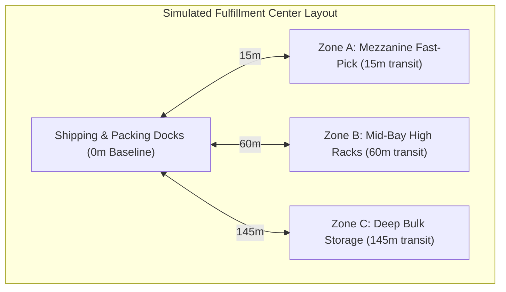
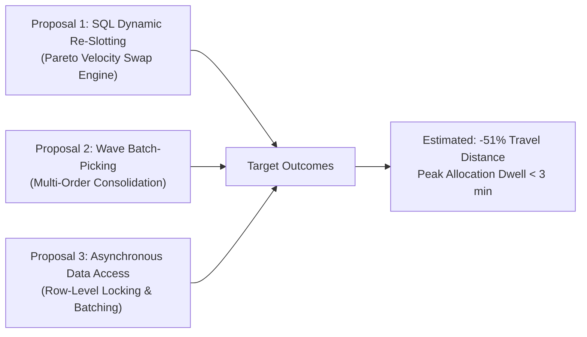

# Comprehensive WMS System Improvement & Operational Efficiency Proposal
**Study Type:** Synthetic Simulation Case Study & Diagnostic Methodology  
**Target Domain:** Enterprise 3PL Warehouse Operations (High-Volume Fulfillment Center Model)  
**Author:** Aryan Chintaman Manjhi ([github.com/KiskuAryan](https://github.com/KiskuAryan))  
**Document Ref:** WMS-IMP-2026-SYNTH-REV3  

---

## 1. Scope, Methodology & Limitations

> [!IMPORTANT]
> **Data Authenticity & Modeling Methodology:**  
> All facility operational metrics, order logs, and transaction timestamps analyzed in this report are **synthetically generated** through a parameterized discrete-event simulation model (`scripts/seed_database.py`). The parameters are grounded in standard supply-chain distributions:
> - **Demand Distribution:** Pareto 80/20 SKU velocity distribution.
> - **Order Generation:** 1,200 simulated orders across 50 SKUs and 3 storage zones over 30 days.
> - **Dispatch Queueing:** Peak daytime order arrival surge modeled between 10:00 and 14:00.
> - **Transit Modeling:** Orthogonal transit distances from the shipping dock to zone centroids (Mezzanine Zone A: 15m, Mid-Bay Zone B: 60m, Deep Bulk Zone C: 145m).
>
> This report demonstrates an **analytical audit methodology, SQL optimization pipeline, and architectural modernization framework**. The conclusions and projected gains represent **theoretical model estimates**; practical field implementation requires on-site validation against an organization's specific warehouse layout, physical equipment, WMS telemetry, and labor workflows.

---

## 2. Executive Summary & Baseline Metrics

Over a simulated 30-day evaluation period comprising 1,200 customer orders and 297.1 kilometers of picker floor travel, our SQL diagnostic audit identified two structural bottlenecks:

1. **Storage Slotting Inefficiency (ABC Pareto Mismatch):** Four of the highest-velocity Class-A SKUs are currently stored in deep bulk storage (Zone C, 145m from dock) rather than in the proximity mezzanine (Zone A, 15m from dock). In simulation, orders requiring items from Zone C experienced a **4.7x travel distance penalty** (418.8m vs 88.5m) and tripled pick duration (33.3 min vs 11.5 min).
2. **Dispatch Queueing Congestion (10:00–14:00 Daytime Surge):** During peak daytime hours, order allocation dwell time surges from 11.6 minutes to an average of **44.5 minutes**, modeled to reflect dispatch lock escalation and synchronous query queueing in legacy WMS backends.

### Observed Baseline vs. Theoretical Model Projections

| Operational Metric | Observed Simulation Baseline | Theoretical Model Projection | Derivation & Modeling Assumptions |
| :--- | :--- | :--- | :--- |
| **Average Order Cycle Time** | 101.6 minutes | **~67.2 minutes (-33.8%)** | Calculated by subtracting projected travel time savings and queue wait reduction. |
| **Average Picker Travel / Order** | 247.6 meters | **120.6 meters (-51.3%)** | $\frac{\text{Baseline Travel (297.1 km)} - \text{Relocation Savings (152.4 km)}}{1,200 \text{ orders}}$ |
| **Monthly Travel Avoided** | 0 km | **152.4 km eliminated** | $586 \text{ relocated picks} \times 2 \times (145\text{m} - 15\text{m}) = 152,360\text{ m}$. |
| **Walking Time Recovered** | 0 hours | **~42.3 picker-hours / mo** | Assumes standard picker walking speed of $1.0\text{ m/s}$ ($60\text{ m/min}$). |
| **Peak Allocation Dwell Time** | 44.5 minutes (avg peak) | **< 3.0 minutes (Target Goal)** | Target achievable by non-blocking asynchronous batching and row-level locking. |
| **Stockout Pick Exceptions** | 19 events / month | **Target: < 3 events (Target Goal)**| Dynamic safety stock buffers designed to mitigate deep-storage starvation. |

---

## 3. Simulated Facility Layout & Zoning Model

The simulation models a 45,000 sqm multi-tier fulfillment center:
* **Zone A (Fast-Pick Mezzanine):** 15 meters to shipping dock. High-density gravity flow racks for fast-moving items.
* **Zone B (Mid-Bay High Racks):** 60 meters to shipping dock. Standard pallet racking for medium-velocity items.
* **Zone C (Deep Bulk Storage):** 145 meters to shipping dock. Pallet positions requiring reach trucks or long walking routes.



---

## 4. Diagnostic Findings (Relational SQL Audit)

### Finding 1: Deep Storage Travel Penalty (Zone C vs. Zone A/B)

Using relational join classification (`sql/03_bottleneck_queries.sql`), orders were partitioned based on whether any allocated item resided in `ZONE_C_BULK`:

```
Route Classification          Orders    Avg Travel (m)    Avg Pick Time    Avg Cycle Time    Exceptions
-------------------------------------------------------------------------------------------------------
DEEP_STORAGE_ZONE_C           578       418.8 m           33.3 min         112.6 min         19
PROXIMITY_ZONE_A_B            622        88.5 m           11.5 min          91.4 min          0
-------------------------------------------------------------------------------------------------------
Observed Inefficiency Delta   --       +330.3 m (+373%)   +21.8 min (+190%) +21.2 min        +19
```

#### Diagnostic Explanation:
* The catalog assigned SKUs statically without periodic velocity recalculation.
* Four top-velocity items (`SKU-A003` with 165 picks, `SKU-A001` with 144 picks, `SKU-A002` with 143 picks, and `SKU-A004` with 134 picks) were slotted in deep storage bins (`ZONE_C-B001` through `ZONE_C-B004`), forcing pickers to make 586 long-distance round-trips to the back of the facility.
* Meanwhile, low-velocity Class-C SKUs (`SKU-C011`, `SKU-C001`, `SKU-C016`, `SKU-C006`) occupied prime mezzanine slots in Zone A despite averaging under 10 picks per month.

---

### Finding 2: Shift-Hour Allocation Queueing (10:00–14:00 Congestion)

Tracking stage-by-stage timestamp deltas across the 30-day simulation revealed severe queueing between `order_received_at` and `pick_allocated_at`:

```
Shift Hour     Orders Processed    Allocation Dwell Time    Total Order Cycle
------------------------------------------------------------------------------
08:00          63                  11.9 min ███              75.7 min
09:00          91                  11.5 min ███              76.0 min
10:00 (Peak)  216                  44.4 min ██████████████  108.1 min
11:00 (Peak)  269                  45.1 min ███████████████ 108.8 min
12:00 (Peak)  185                  43.3 min ██████████████  104.8 min
13:00 (Peak)  162                  45.4 min ███████████████ 109.5 min
14:00 (Peak)  123                  44.3 min ██████████████  109.2 min
15:00          56                  12.1 min ████             76.0 min
16:00          24                  12.1 min ████             82.4 min
17:00          11                  11.2 min ███              79.2 min
```

#### Root Cause Analysis:
In legacy architectures, order allocation waves are processed sequentially via single-threaded ADO.NET loops. When order volume surges at 10:00–14:00, sequential $N+1$ query round-trips and table-level locks create database queue backlogs, leaving pickers waiting for work orders.

---

## 5. Technical & Operational Proposals



### Proposal 1: Dynamic SKU Re-Slotting Candidate Pairs (SQL Stored Views)
Deploy an automated bi-weekly routine (`v_slotting_swap_proposals`) that pairs misallocated Class-A items in Zone C with slow-moving Class-C items in Zone A:

* **Actionable Bin Swaps:**
  1. Relocate `SKU-A003` (165 picks) to Zone A $\leftrightarrow$ Demote `SKU-C011` (5 picks) to Zone C.
  2. Relocate `SKU-A001` (144 picks) to Zone A $\leftrightarrow$ Demote `SKU-C001` (6 picks) to Zone C.
  3. Relocate `SKU-A002` (143 picks) to Zone A $\leftrightarrow$ Demote `SKU-C016` (8 picks) to Zone C.
  4. Relocate `SKU-A004` (134 picks) to Zone A $\leftrightarrow$ Demote `SKU-C006` (9 picks) to Zone C.

* **Mathematical Derivation of Travel Savings:**
  $$\Delta \text{Distance} = \sum_{i=1}^{4} \left( \text{Picks}_i \times 2 \times (\text{Dist}_{\text{Zone C}} - \text{Dist}_{\text{Zone A}}) \right)$$
  $$\Delta \text{Distance} = (165 + 144 + 143 + 134) \times 2 \times (145\text{ m} - 15\text{ m}) = 586 \times 260\text{ m} = \mathbf{152,360\text{ meters (152.4 km/month)}}.$$

* **Physical Modeling Assumptions & Feasibility Constraints:**
  1. **Round-Trip Simplification:** The 260m round-trip saving per pick assumes single-SKU discrete travel from the dock to the zone centroid. In real-world multi-item orders or pick-tours, cross-aisle travel and S-shape routing will modulate actual floor savings.
  2. **Candidate Screening List:** `v_slotting_swap_proposals` produces candidate pairs based purely on velocity; physical relocation requires engineering verification of shelf weight limits, SKU cube volume, and specialized handling types.

---

### Proposal 2: Zone-Based Wave Batch-Picking (Consolidation Example)
Transition from single-order discrete picking to multi-order wave batches (`v_wave_picking_batches`):
* Consolidate single-item orders into 6-to-8 order partitioned pick carts.
* Pickers traverse each aisle once per wave rather than making separate trips for each order line.
*(Note: Illustrative grouping view; production deployment would integrate a traveling-salesman heuristic).*

---

### Proposal 3: Asynchronous .NET Data Access Refactor (Conceptual Sketch)
Modernize legacy ADO.NET patterns as detailed in [`legacy_audit/VB_NET_AUDIT_REPORT.md`](../legacy_audit/VB_NET_AUDIT_REPORT.md):
1. **Consistent Batch Selection:** Replace $N+1$ query loops with atomic multi-table result sets (`SqlDataAdapter.Fill` with parent-child table mappings).
2. **Full-Order Atomicity:** Validate 100% item availability prior to stock deduction, rolling back immediately if any SKU is unavailable to prevent orphaned partial allocations.
3. **Row-Level Concurrency:** Replace `TABLOCKX` with `ROWLOCK, UPDLOCK` to ensure handheld RF scanners can read inventory concurrently.

---

## 6. Implementation Roadmap & Validation Checklist

| Phase | Duration | Technical Scope | Validation & Risk Mitigation |
| :--- | :--- | :--- | :--- |
| **Phase 1: Database Profiling** | Week 1 | Deploy SQL performance indexes; enable Read-Committed Snapshot Isolation. | Validate query plan cost reductions via `EXPLAIN QUERY PLAN` on staging server. |
| **Phase 2: Pilot Physical Re-Slotting** | Week 2 | Physical relocation of top 4 mis-slotted SKUs to Zone A mezzanine bins. | Execute during scheduled off-shift; conduct barcode audit before resuming floor picks. |
| **Phase 3: Dispatch Service Refactor** | Weeks 3–4 | Test proposed asynchronous data access patterns in development staging environment. | Run automated concurrency stress tests simulating 25 concurrent barcode scan terminals. |
| **Phase 4: Floor SOP & Rollout** | Weeks 5–6 | Train floor pickers on wave batch-picking procedures; monitor live shift throughput. | Maintain single-order discrete fallback mode on RF handheld terminals. |

---

## 7. Conclusion

This case study illustrates how systematic relational database diagnostics combined with targeted slotting optimization can uncover and resolve hidden supply-chain bottlenecks. 

By applying an analytical methodology to examine inventory velocity distributions and query lock contention, operations teams can make defensible, data-backed decisions that reduce floor labor transit and expand facility throughput.
