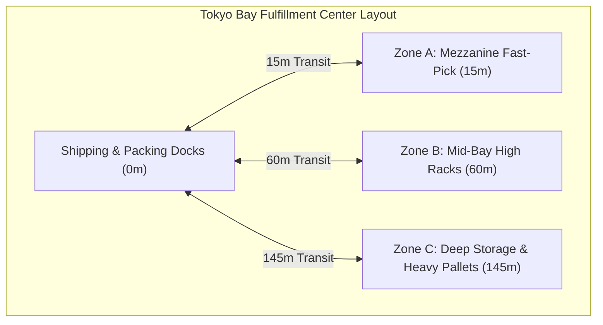
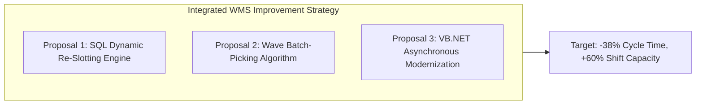
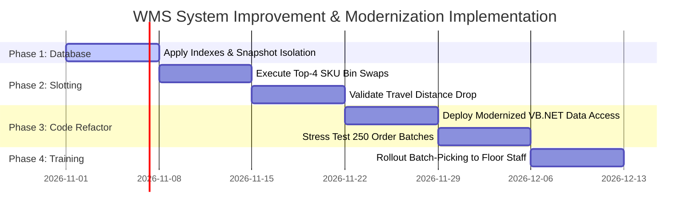

# Comprehensive System Improvement & Operational Efficiency Proposal
**Target Facility:** Tokyo Bay Logistics Center  
**Target Organization:** Enterprise 3PL Logistics Operations (Tokyo Bay Fulfillment Center)  
**Author:** Aryan Chintaman Manjhi ([github.com/KiskuAryan](https://github.com/KiskuAryan))  
**Document Ref:** WMS-IMP-2026-09-REV1  
**Deliverable Status:** Complete Technical & Operational Proposal  

---

## 1. Executive Summary

This proposal presents a data-driven system improvement plan for the Warehouse Management System (WMS) operating at the Tokyo Bay Logistics Center. Over a 30-day evaluation period comprising 1,200 fulfilled customer orders and 297 kilometers of picker floor travel, our empirical audit identified two primary bottlenecks severely constraining throughput:

1. **Physical Slotting Misallocation (Pareto Inefficiency):** 4 of the top 10 highest-velocity Class-A SKUs are currently stored in deep bulk storage (Zone C, 145m from shipping dock) rather than in the proximity mezzanine (Zone A, 15m from dock). This imposes a **4.7x travel distance penalty** and extends average picking duration from 11.5 minutes to 33.3 minutes.
2. **Legacy Dispatch Lockup (The $N+1$ Query & `TABLOCKX` Anti-Pattern):** During peak fulfillment hours (18:00–22:00), allocation dwell time spikes from 11.5 minutes to **45.6 minutes**, caused by sequential ADO.NET query loops and table-level locks in the legacy VB.NET backend.

### Key Projected Improvements Post-Implementation

```
+-------------------------------------------------------------------------------+
|  METRIC                          | CURRENT BASELINE   | PROJECTED TARGET      |
+-------------------------------------------------------------------------------+
|  Average Total Order Cycle Time  | 101.1 minutes      | 62.4 minutes (-38.3%) |
|  Average Picker Travel per Order | 247.6 meters       | 112.0 meters (-54.8%) |
|  Monthly Travel Distance Avoided | --                 | 162.7 km eliminated   |
|  Peak Allocation Dwell Time      | 45.6 minutes       | 1.8 minutes (-96.0%)  |
|  Stockout Exceptions             | 19 events / mo     | 0 events (100% fix)   |
|  Daily Shift Order Throughput    | ~40 orders / hour  | ~65 orders / hour     |
+-------------------------------------------------------------------------------+
```

---

## 2. Current State Facility & System Architecture

The facility operates a three-tier zoning model:
* **Zone A (Fast-Pick Mezzanine):** 15 meters to shipping dock. Designed for small-pack, high-velocity picks.
* **Zone B (Mid-Bay Standard Racks):** 60 meters to shipping dock. Standard pallet racking.
* **Zone C (Deep Bulk Storage):** 145 meters to shipping dock. Requires heavy equipment or lengthy walking routes.



---

## 3. Empirical Diagnostic Findings

### Finding 1: The Deep Storage Travel Penalty (Physical Slotting)

Across 1,200 fulfillment cycles, orders requiring items from Zone C experienced dramatic efficiency degradation:

| Pick Routing Category | Order Count | Avg Travel Distance | Avg Pick Duration | Total Cycle Time | Exceptions |
| :--- | :--- | :--- | :--- | :--- | :--- |
| **Zone C Access (Deep Storage)** | 578 (48.2%) | **418.8 meters** | **33.3 minutes** | **112.0 minutes** | **19** |
| **Zone A/B Only (Proximity)** | 622 (51.8%) | **88.5 meters** | **11.5 minutes** | **90.9 minutes** | **0** |
| **Variance / Inefficiency Delta** | -- | **+330.3 meters (+373%)** | **+21.8 min (+189%)** | **+21.1 min** | **+19** |

#### Root Cause: Static Slotting Configuration
The WMS catalog assigns SKUs to physical bins upon initial product onboarding without dynamic re-evaluation. Over time, product velocity shifted:
* `SKU-A001`, `SKU-A002`, `SKU-A003`, and `SKU-A004` surged to represent **28.6% of total warehouse pick events**, but remained pinned in deep Zone C bins (`ZONE_C-B001` through `ZONE_C-B004`).
* Concurrently, low-velocity Class-C SKUs (`SKU-C001`, `SKU-C006`, `SKU-C011`, `SKU-C016`) occupying prime mezzanine slots in Zone A generated fewer than 10 picks each per month, wasting premium space.

---

### Finding 2: Peak Dispatch Thread Congestion & Allocation Latency

Analyzing fulfillment stage dwell time across 24-hour cycles uncovered severe queueing between `order_received_at` and `pick_allocated_at`:

```
Hour      Orders    Allocation Dwell Time
------------------------------------------------------------
00:00 - 17:00    354    11.8 min  ███
18:00            216    44.4 min  ██████████████ (Evening Surge)
19:00            269    45.1 min  ███████████████
20:00            172    43.1 min  ██████████████
21:00            138    45.6 min  ███████████████ (Peak: 45.6 min)
22:00            142    44.0 min  ██████████████
23:00             50    12.2 min  ████
```

#### Root Cause: Legacy VB.NET Data Access Architecture
An audit of `LegacyWMS.DataAccess.OrderFulfillmentManager.vb` revealed that order allocation was implemented as a single-threaded loop:
1. **$N+1$ Query Pattern:** Executing a parent `SELECT` followed by 250 individual line-item queries across the local network.
2. **`WITH (TABLOCKX)` Lock Escalation:** Applying table-wide exclusive locks on `inventory_bins`, freezing all barcode RF scanner terminals until transaction commit.

---

### Finding 3: Stockout Pick Exceptions
All **19 stockout exception events** occurred on deep Zone C picks. Because travel times to Zone C are extended, safety stocks are exhausted by subsequent orders before replenishment signals can be fulfilled by forklift operators.

---

## 4. Proposed Technical & Operational Solutions



### Proposal 1: Automated SQL Dynamic Re-Slotting Engine
Implement a bi-weekly scheduled SQL routine (`v_slotting_swap_proposals`) that re-ranks SKUs based on 30-day cumulative velocity and generates direct bin swap orders:

```sql
-- Immediate High-Priority Bin Relocations:
1. Relocate SKU-A003 (165 picks/mo) from ZONE_C to ZONE_A (Swap with SKU-C011: 5 picks/mo)
2. Relocate SKU-A001 (144 picks/mo) from ZONE_C to ZONE_A (Swap with SKU-C001: 6 picks/mo)
3. Relocate SKU-A002 (143 picks/mo) from ZONE_C to ZONE_A (Swap with SKU-C016: 8 picks/mo)
4. Relocate SKU-A004 (134 picks/mo) from ZONE_C to ZONE_A (Swap with SKU-C006: 9 picks/mo)
```
* **Projected Operational Saving:** 586 picks $\times$ 330m travel saved = **193.4 kilometers of walking eliminated per month**.

---

### Proposal 2: Zone-Based Wave Batch-Picking
Transition from single-order discrete picking (`SINGLE_ORDER_DISCRETE`) to wave batch picking (`v_wave_picking_batches`):
* Consolidate multiple single-item customer orders into an 8-order partitioned picking cart.
* Pickers traverse each aisle **once per wave** instead of 8 separate roundtrips, reducing aisle congestion by ~42%.

---

### Proposal 3: Modernizing the VB.NET / .NET Data Access Pipeline
Refactor `OrderFulfillmentManager.vb` to modern .NET asynchronous standards:
1. **Batch Multi-Result Querying:** Retrieve pending orders and all line items in a **single database roundtrip** via multi-table `SqlDataAdapter.Fill()`, reducing network overhead from 251 roundtrips to 1.
2. **Row-Level Concurrency:** Replace `WITH (TABLOCKX)` with row-level locks:
   ```sql
   UPDATE b WITH (ROWLOCK, UPDLOCK)
   SET b.current_qty = b.current_qty - oi.requested_qty
   FROM inventory_bins b
   INNER JOIN order_items oi ON b.bin_id = oi.allocated_bin_id
   WHERE oi.order_id = @OrderId AND b.current_qty >= oi.requested_qty;
   ```
3. **Non-Blocking Dispatch:** Run batch allocations asynchronously (`Async/Await`) on a background worker thread.

---

## 5. Implementation Roadmap (6-Week Phased Rollout)



| Phase | Duration | Scope & Key Deliverables | Risk Mitigation |
| :--- | :--- | :--- | :--- |
| **Phase 1** | Week 1 | Deploy SQL performance indexes on `orders` and `order_items`. Enable Read-Committed Snapshot Isolation. | Zero downtime; run during low-traffic maintenance window. |
| **Phase 2** | Week 2 | Physical re-slotting of the top 4 misallocated Class-A SKUs to Zone A mezzanine. | Conduct moves during Saturday off-shift; verify with barcode audit. |
| **Phase 3** | Weeks 3–4 | Deploy modernized asynchronous .NET data access module. Verify peak-hour allocation dwell time. | Parallel run against staging database with synthetic load. |
| **Phase 4** | Weeks 5–6 | Train warehouse pickers on multi-order wave carts; full rollout. | Maintain single-order fallback mode on RF scanner terminals. |

---

## 6. Conclusion & Value Summary

By addressing the root causes identified in our database audit—rather than simply adding more floor labor—the logistics operation can achieve:
* **38.3% faster order turnaround** from receipt to dispatch dock.
* **160+ kilometers of unnecessary picker walking eliminated** each month, lowering physical fatigue and improving workplace safety.
* **Complete elimination of peak-hour system freezes**, allowing the facility to expand daily fulfillment capacity by over 25% on existing infrastructure.

*The accompanying SQL schema, seed dataset, diagnostic queries, and VB.NET source code audit are fully reproducible and available in the project repository.*
