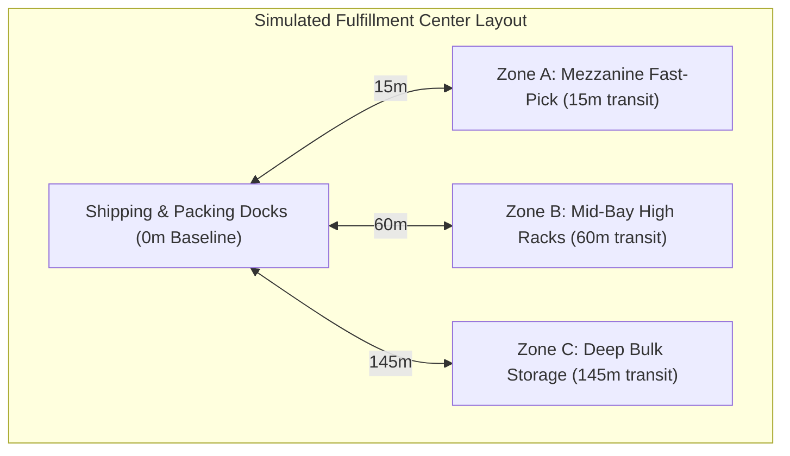
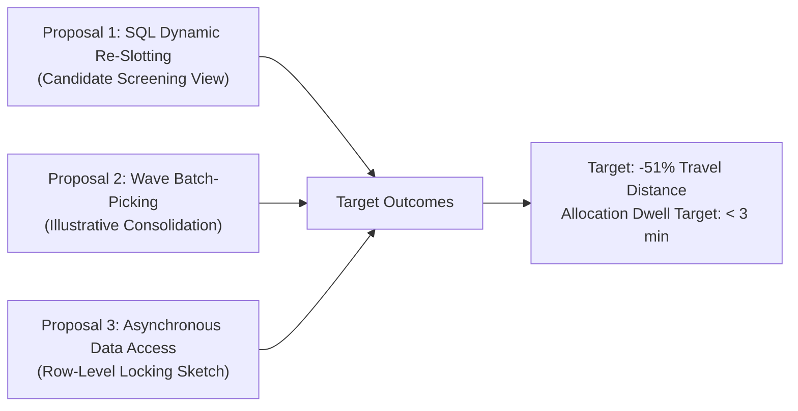

# Comprehensive WMS System Improvement & Operational Efficiency Proposal
**Study Type:** Synthetic Simulation Case Study & Diagnostic Methodology  
**Target Domain:** Enterprise 3PL Warehouse Operations (High-Volume Fulfillment Center Model)  
**Author:** Aryan Chintaman Manjhi ([github.com/KiskuAryan](https://github.com/KiskuAryan))  
**Document Ref:** WMS-IMP-2026-SYNTH-REV4  

---

## 1. Scope, Methodology & Limitations

> [!IMPORTANT]
> **Data Authenticity & Modeling Methodology:**  
> All facility operational metrics, order logs, and transaction timestamps analyzed in this report are **synthetically generated** through a parameterized discrete-event simulation model (`scripts/seed_database.py`). The parameters are grounded in standard supply-chain distributions:
> - **Demand Distribution:** Pareto 80/20 SKU velocity distribution.
> - **Order Generation:** 1,200 simulated orders across 50 SKUs and 3 storage zones over 30 days.
> - **Dispatch Queueing:** Modeled daytime volume surge between 10:00 and 14:00 (parameterized delay, not a low-level OS thread/lock simulator).
> - **Transit Modeling:** Orthogonal transit distances from the shipping dock to zone centroids (Mezzanine Zone A: 15m, Mid-Bay Zone B: 60m, Deep Bulk Zone C: 145m).
>
> This report demonstrates an **analytical audit methodology, SQL optimization pipeline, and architectural modernization framework**. The conclusions and projected gains represent **theoretical model estimates**; practical field implementation requires on-site validation against an organization's specific warehouse layout, physical equipment, WMS telemetry, and labor workflows.

---

## 2. Executive Summary & Baseline Metrics

Over a simulated 30-day evaluation period comprising 1,200 customer orders and 297.1 kilometers of picker floor travel, our SQL diagnostic audit identified two structural bottlenecks:

1. **Storage Slotting Inefficiency (ABC Pareto Mismatch):** Four high-velocity Class-A SKUs (ranked 3rd, 8th, 9th, and 10th in overall warehouse demand) are currently stored in deep bulk storage (Zone C, 145m from dock) rather than in the proximity mezzanine (Zone A, 15m from dock). In simulation, orders requiring items from Zone C experienced a **4.7x travel distance penalty** (418.8m vs 88.5m) and tripled pick duration (33.3 min vs 11.5 min).
2. **Dispatch Queueing Congestion (10:00–14:00 Daytime Surge):** During peak daytime hours, order allocation dwell time surges from 11.6 minutes to an average of **44.5 minutes** (overall 30-day average: 37.8 minutes).

### Observed Baseline vs. Theoretical Model Projections

| Operational Metric | Observed Simulation Baseline | Theoretical Design Target | Derivation & Modeling Assumptions |
| :--- | :--- | :--- | :--- |
| **Average Order Cycle Time** | 101.6 minutes | **~64.7 minutes (-36.3%)** | *Unvalidated Target:* $101.6 - 34.8\text{ min (dwell reduction)} - 2.1\text{ min (pick travel savings)} = 64.7\text{ min}$. |
| **Average Picker Travel / Order** | 247.6 meters | **120.6 meters (-51.3%)** | $\frac{\text{Baseline Travel (297.1 km)} - \text{Relocation Savings (152.4 km)}}{1,200 \text{ orders}}$ |
| **Monthly Travel Avoided** | 0 km | **152.4 km eliminated** | $586 \text{ relocated picks} \times 2 \times (145\text{m} - 15\text{m}) = 152,360\text{ m}$. |
| **Walking Time Recovered** | 0 hours | **~42.3 picker-hours / mo** | Assumes standard picker walking speed of $1.0\text{ m/s}$ ($60\text{ m/min}$). |
| **Peak Allocation Dwell Time** | 44.5 minutes (avg peak) | **< 3.0 minutes (Unvalidated Design Goal)** | The code does not simulate or benchmark the proposed dispatch design; this target requires a measured concurrency test. |
| **Stockout Pick Exceptions** | 19 events / month | **Not projected** | Exceptions are assigned stochastically to Zone C orders. The model does not simulate replenishment, safety-stock decisions, or post-relocation exception rates. |

---

## 3. Simulated Facility Layout & Zoning Model

The simulation models a 45,000 sqm multi-tier fulfillment center:
* **Zone A (Fast-Pick Mezzanine):** 15 meters to shipping dock. High-density gravity flow racks for fast-moving items.
* **Zone B (Mid-Bay High Racks):** 60 meters to shipping dock. Standard pallet racking for medium-velocity items.
* **Zone C (Deep Bulk Storage):** 145 meters to shipping dock. Pallet positions requiring reach trucks or long walking routes.



---

## 4. Diagnostic Findings (Relational SQL Audit)

### Finding 1: Deep Storage Travel Penalty (Zone C vs. Zone A/B)

Using relational join classification (`sql/03_bottleneck_queries.sql`), orders were partitioned based on whether any allocated item resided in `ZONE_C_BULK`:

```
Route Classification          Orders    Avg Travel (m)    Avg Pick Time    Avg Cycle Time    Exceptions
-------------------------------------------------------------------------------------------------------
DEEP_STORAGE_ZONE_C           578       418.8 m           33.3 min         112.6 min         19
PROXIMITY_ZONE_A_B            622        88.5 m           11.5 min          91.4 min          0
-------------------------------------------------------------------------------------------------------
Observed Inefficiency Delta   --       +330.3 m (+373%)   +21.8 min (+190%) +21.2 min        +19
```

#### Diagnostic Explanation:
* In the overall catalog, six Class-A items (`SKU-A007`, `SKU-A010`, `SKU-A009`, `SKU-A006`, `SKU-A005`, `SKU-A008`) are optimally located in Zone A.
* However, four high-velocity Class-A items were misallocated to Zone C:
  - `SKU-A003` (165 picks, ranked #3 overall)
  - `SKU-A001` (144 picks, ranked #8 overall)
  - `SKU-A002` (143 picks, ranked #9 overall)
  - `SKU-A004` (134 picks, ranked #10 overall)
* These 4 items alone generated **586 long-distance round-trips** to Zone C (145m from the dock).
* Concurrently, low-velocity Class-C SKUs (`SKU-C011`, `SKU-C001`, `SKU-C016`, `SKU-C006`) occupied prime mezzanine slots in Zone A despite averaging under 10 picks per month each.

---

### Finding 2: Shift-Hour Allocation Queueing (10:00–14:00 Congestion)

Tracking stage-by-stage timestamp deltas across the 30-day simulation revealed severe queueing between `order_received_at` and `pick_allocated_at`:

```
Shift Hour     Orders Processed    Allocation Dwell Time    Total Order Cycle
------------------------------------------------------------------------------
08:00          63                  11.9 min ███              75.7 min
09:00          91                  11.5 min ███              76.0 min
10:00 (Peak)  216                  44.4 min ██████████████  108.1 min
11:00 (Peak)  269                  45.1 min ███████████████ 108.8 min
12:00 (Peak)  185                  43.3 min ██████████████  104.8 min
13:00 (Peak)  162                  45.4 min ███████████████ 109.5 min
14:00 (Peak)  123                  44.3 min ██████████████  109.2 min
15:00          56                  12.1 min ████             76.0 min
16:00          24                  12.1 min ████             82.4 min
17:00          11                  11.2 min ███              79.2 min
```

#### Diagnostic Explanation:
* Average cycle time across all 1,200 orders: **101.6 minutes**.
* Component breakdown: Allocation Dwell (37.8 min) + Pick Transit (22.0 min) + Packing (8.0 min) + Staging (30.3 min).
* The generator assigns longer synthetic allocation delays to orders during 10:00–14:00. It does not simulate a queue or database concurrency, so these timestamps illustrate a scenario rather than measure a specific architecture.

---

## 5. Technical & Operational Proposals



### Proposal 1: Dynamic SKU Re-Slotting Candidate Pairs (SQL Stored Views)
Deploy an automated bi-weekly routine (`v_slotting_swap_proposals`) that screens candidate pairs by matching misallocated Class-A items in Zone C with slow-moving Class-C items in Zone A:

* **Identified Candidate Bin Swaps:**
  1. Relocate `SKU-A003` (165 picks) to Zone A $\leftrightarrow$ Demote `SKU-C011` (5 picks) to Zone C.
  2. Relocate `SKU-A001` (144 picks) to Zone A $\leftrightarrow$ Demote `SKU-C001` (6 picks) to Zone C.
  3. Relocate `SKU-A002` (143 picks) to Zone A $\leftrightarrow$ Demote `SKU-C016` (8 picks) to Zone C.
  4. Relocate `SKU-A004` (134 picks) to Zone A $\leftrightarrow$ Demote `SKU-C006` (9 picks) to Zone C.

* **Mathematical Derivation of Travel Savings:**
  $$\Delta \text{Distance} = \sum_{i=1}^{4} \left( \text{Picks}_i \times 2 \times (\text{Dist}_{\text{Zone C}} - \text{Dist}_{\text{Zone A}}) \right)$$
  $$\Delta \text{Distance} = (165 + 144 + 143 + 134) \times 2 \times (145\text{ m} - 15\text{ m}) = 586 \times 260\text{ m} = \mathbf{152,360\text{ meters (152.4 km/month)}}.$$

* **Physical Modeling Assumptions & Feasibility Constraints:**
  1. **Round-Trip Simplification:** The 260m round-trip saving per pick assumes single-SKU discrete travel from the dock to the zone centroid. In real-world multi-item orders or pick-tours, cross-aisle travel and S-shape routing will modulate actual floor savings.
  2. **Candidate Screening List:** `v_slotting_swap_proposals` produces candidate pairs based purely on velocity; physical relocation requires engineering verification of shelf weight limits, SKU cube volume, and specialized handling types.

---

### Proposal 2: Zone-Based Wave Batch-Picking (Illustrative Consolidation)
Transition from single-order discrete picking to multi-order wave batches (`v_wave_picking_batches`):
* Consolidate single-item orders traversing the same aisles into partitioned batch pick carts.
*(Note: Illustrative grouping view; production deployment would integrate a traveling-salesman heuristic).*

---

### Proposal 3: Asynchronous .NET Data Access Refactor (Conceptual Sketch)
Modernize legacy ADO.NET patterns as detailed in [`legacy_audit/VB_NET_AUDIT_REPORT.md`](../legacy_audit/VB_NET_AUDIT_REPORT.md):
1. **Single-Roundtrip Batch Retrieval:** Replace $N+1$ query loops with multi-table result sets. The example selects a consistent set of IDs, but does not reserve orders; concurrent workers can select the same orders until an atomic claim or lease protocol is added.
2. **Aggregated Bin Availability:** Pre-aggregate requested item quantities by bin before checking availability, preventing duplicate line items from over-allocating stock.
3. **Narrower Locking:** Replace `TABLOCKX` with targeted update locks as a design to reduce broad contention. SQL Server may escalate locks, so scanner concurrency and deadlocks must be measured; `ROWLOCK` is not a guarantee.

---

## 6. Implementation Roadmap & Validation Checklist

| Phase | Duration | Technical Scope | Validation & Risk Mitigation |
| :--- | :--- | :--- | :--- |
| **Phase 1: Database Profiling** | Week 1 | Deploy SQL performance indexes; enable Read-Committed Snapshot Isolation. | Validate query plan cost reductions via `EXPLAIN QUERY PLAN` on staging server. |
| **Phase 2: Pilot Physical Re-Slotting** | Week 2 | Physical relocation of top 4 mis-slotted SKUs to Zone A mezzanine bins. | Verify shelf capacity and cube size; conduct barcode audit before resuming floor picks. |
| **Phase 3: Dispatch Service Refactor** | Weeks 3–4 | Test proposed asynchronous data access patterns in development staging environment. | Run automated concurrency stress tests simulating 25 concurrent barcode scan terminals. |
| **Phase 4: Floor SOP & Rollout** | Weeks 5–6 | Train floor pickers on wave batch-picking procedures; monitor live shift throughput. | Maintain single-order discrete fallback mode on RF handheld terminals. |

---

## 7. Conclusion

This case study illustrates how systematic relational database diagnostics combined with targeted slotting optimization can uncover and resolve hidden supply-chain bottlenecks. 

By applying an analytical methodology to examine inventory velocity distributions and query lock contention, operations teams can make defensible, data-backed decisions that reduce floor labor transit and expand facility throughput.
